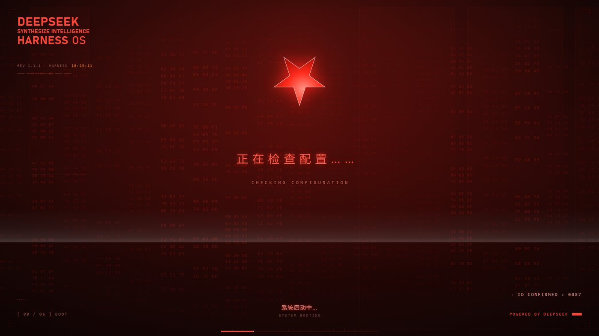
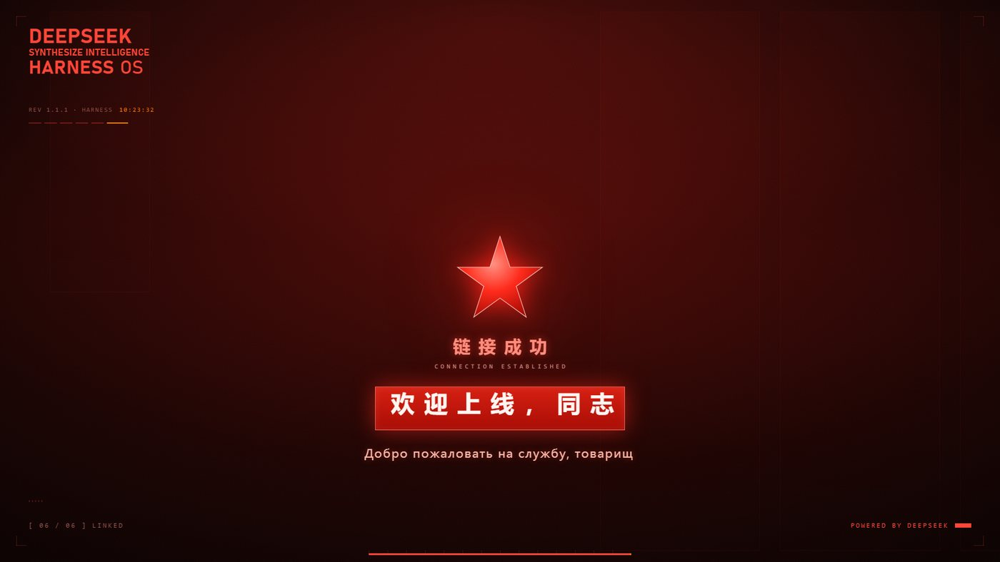

<p align="center">
  
</p>

# dsh-redstar-boot

**给 DeepSeek Harness 换一段黑红开机动画：红星、数据流、中俄双语的「欢迎上线，同志」。**

开机 → 黑幕 DeepSeek 标识 → 洗白成黑红底板 → 全屏数据流里依次自检
（正在检查配置…… / 正在查询文件…… / 正在链接中央服务器……）→ 原六步访问授权
→ 链接成功 → 光标打出中俄双语欢迎语，红星停转、落到正中、放大消失 → 揭幕进主界面。

| 开机自检 | 终幕 |
| --- | --- |
|  |  |

## 效果

- **黑红底板**：整屏换成黑红主题，红星、红色数据流、红色字幕是唯一的强调色。
- **正中间上方的五角星**：0.62 秒转一圈，带红色辉光；终幕停转、精确落到视口正中。
- **数据流自检**：全屏十六进制雨向下滚动，三行检查语依次用它自己的光标打出来，
  读完的行自动压暗。
- **六步互动授权**：原流程原样保留（需要访问许可 / 身份资料确认 / 接收访问需求 /
  开始读取权限 / 读取完毕·核验通过 / 欢迎），只把底板换成黑红。
- **终幕**：`链接成功 / CONNECTION ESTABLISHED` 出现后，中文「欢迎上线，同志」与
  俄文「Добро пожаловать на службу, товарищ」依次光标打出；同时红星停转、居中，
  随后放大消失并带一层红光爆发，最后揭幕。
- **DeepSeek Harness 同款图标**：开场鲸鱼直接用桌面端 `resources/icon.png` 那张应用图标
  （320px 内联，白底圆角方块 + 深蓝鲸鱼），不再被主题染红。
- **设置页**：播放时机（每次会话 / 每天 / 总是）、速度倍率、身份名称与编号、
  是否要求确认、是否允许跳过、音效音量、语音（系统 TTS）、文案。
- **零网络**：没有任何远程请求；图标与样式都随包走。

## 安装

```sh
# 从 npm（上架后）
dsh plugin --profile web add dsh-redstar-boot

# 从本地压缩包
dsh plugin --profile web add ./dsh-redstar-boot-0.1.0.tgz
```

桌面端请在 **设置 → 插件** 里安装（那个 profile 由应用自己管理），装完完全退出再打开。

## 关于声音

本包**不附带**上游插件里的真人录音素材（那批素材来自第三方视频，权利归原权利人）。
语音会自动回落到系统 TTS，界面音效回落到 WebAudio 现场合成，功能不受影响；
如果想用真声素材，把 mp3 放进 `lib/assets/` 即可（路由按文件名白名单读取）。

## 兼容性

| 载体 | 状态 |
| --- | --- |
| `dsh web`（web profile） | 支持 |
| DeepSeek Harness Desktop | 支持（Host 没有 `webServer` 时由浏览器半侧自举） |
| 与 `dsh-startup-screen` 同时安装 | 不建议：两段开机动画会各播各的，装一个就好 |

## 许可与致谢

MIT。这个插件是 [**dsh-startup-screen**](https://github.com/6shenhonghong9/dsh-startup-screen)
（作者 [@6shenhonghong9](https://github.com/6shenhonghong9)，MIT）的改版：
时间线引擎、六步授权流程、桌面端自举、配置架構都来自上游；
黑红主题、五角星、数据流自检、中俄双语终幕、应用图标与矮窗口适配是本版加的。
上游的 550C 片头 HTML 原稿由 [Voidpocket](https://github.com/Voidpocket) 提供。
详见 [CREDITS.md](CREDITS.md)。
